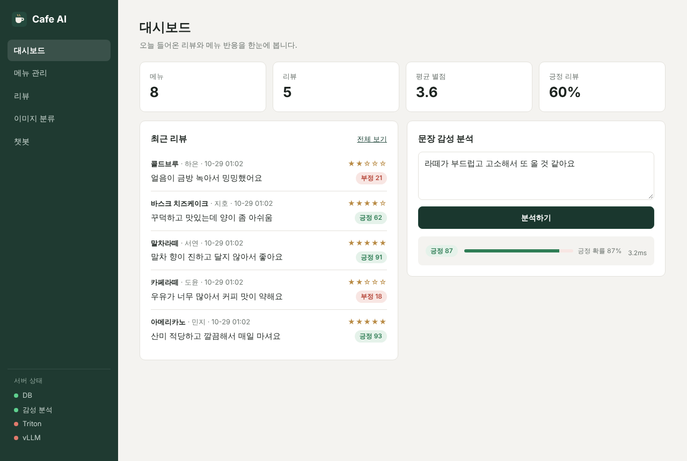

# Cafe AI

카페 메뉴/리뷰 관리 + 리뷰 감성 분석, 이미지 분류(Triton), 챗봇(vLLM)

Demo: https://cafe-ai-zf8u.onrender.com



## Stack

FastAPI, SQLite, scikit-learn, NVIDIA Triton, vLLM, Docker, Render

## Run

```bash
pip install -r requirements.txt
python scripts/train_sentiment.py
uvicorn app.main:app --port 8080
```

```bash
docker compose up -d --build
```

GPU 서버 (Triton, vLLM 포함)

```bash
python scripts/export_resnet18.py
docker compose -f docker-compose.yml -f docker-compose.gpu.yml up -d --build
```

API 문서: `/docs`
